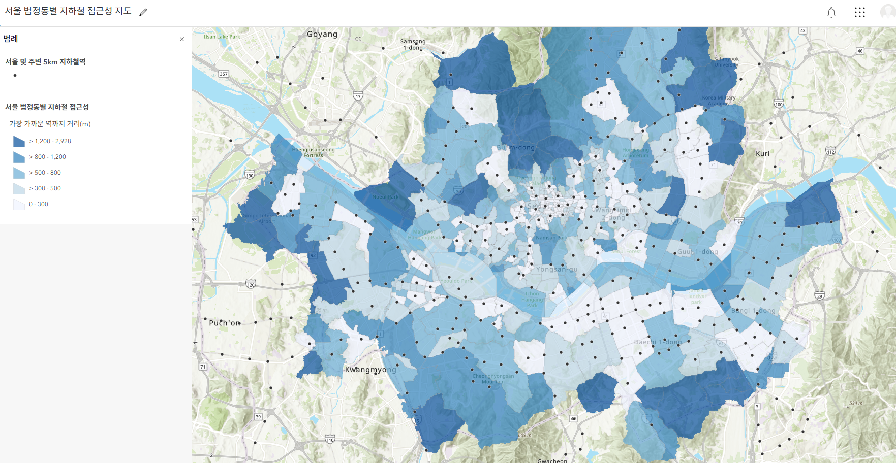
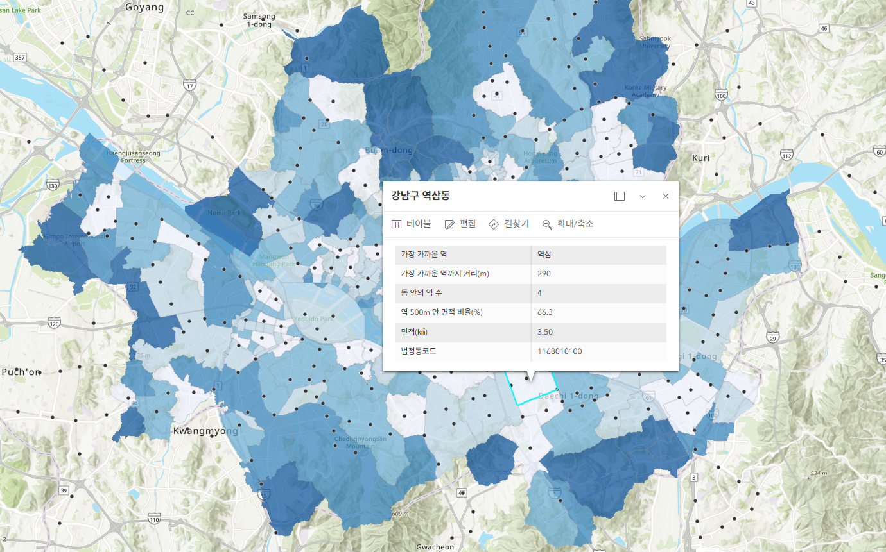
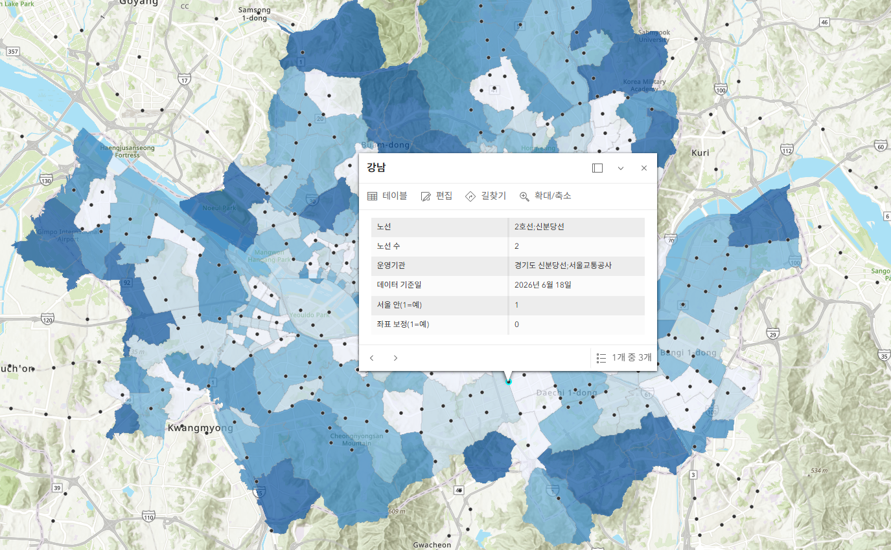
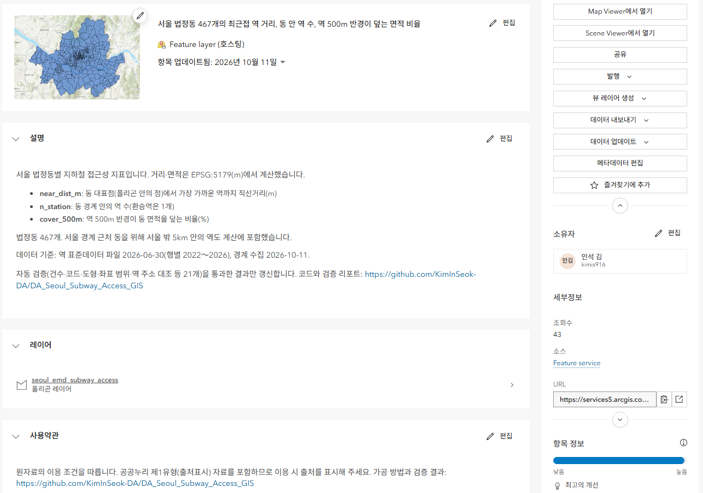
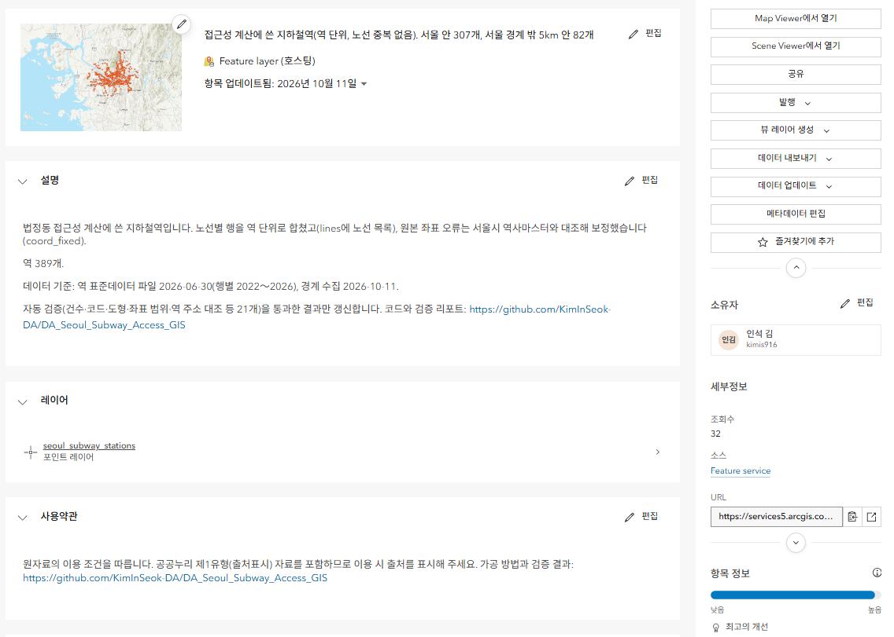
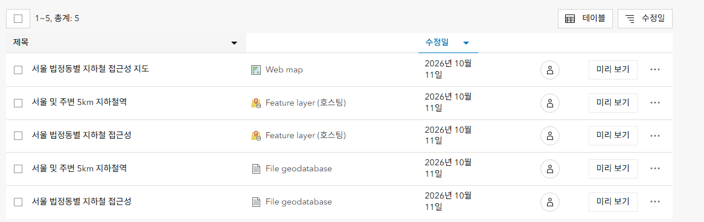

# 서울 법정동별 지하철 접근성 지도

> **공개 지도**: https://kiminseok-da.github.io/DA_Seoul_Subway_Access_GIS/ (로그인 없이 열림)

서울 법정동마다 지하철 접근성 지표를 공공데이터로 계산하고, ArcGIS Online에 Feature Layer·Web Map·앱으로 공개하는 개인 프로젝트입니다.

## 지표

| 지표 | 계산 | 의미 |
|---|---|---|
| `near_dist_m` | 동 대표점에서 가장 가까운 역까지 직선거리(m) | 동네에서 역이 얼마나 먼가 |
| `n_station` | 동 경계 안의 역 수(노선 중복 제거) | 역이 몰린 동 |
| `cover_500m` | 역 500m 반경이 동 면적을 덮는 비율(%) | 동의 몇 %가 역세권인가 |

- 거리·면적은 투영 좌표계 EPSG:5179에서 계산하고, 공개 결과는 EPSG:4326으로 냅니다.
- 대표점은 폴리곤 안에 항상 들어가는 `representative_point()`를 씁니다(오목한 동에서는 중심점이 동 밖으로 나갈 수 있음).
- 서울 경계 근처 동은 서울 밖 역이 더 가까울 수 있어, 역은 서울과 주변 완충 범위까지 포함합니다.

## 데이터 출처

| 데이터 | 출처 | 기준일 | 이용 조건 |
|---|---|---|---|
| 지하철역 좌표 | 공공데이터포털 [전국도시철도역사정보표준데이터](https://www.data.go.kr/data/15013205/standard.do) (국가철도공단) | 파일 2026-06-30, 행별 2022～2026 | 이용허락범위 제한 없음 |
| 역 좌표 대조 | 서울 열린데이터광장 [서울시 역사마스터 정보](https://data.seoul.go.kr/dataList/OA-21232/S/1/datasetView.do) (서울특별시) | 수집 2026-10-11 | 공공누리 제1유형(출처표시) |
| 법정동 경계 | [국토교통부_행정구역도(WMS/WFS)](https://www.data.go.kr/data/15059008/openapi.do) 읍면동 `lt_c_ademd_info`, VWorld WFS | 수집 2026-10-11 | 공공누리 제1유형(출처표시) |
| 법정동코드 표 | 공공데이터포털 [국토교통부_전국 법정동_20260630](https://www.data.go.kr/data/15063424/fileData.do) | 2026-06-30 | 이용허락범위 제한 없음 |

원본 응답(`data/raw/`)은 저장소에 올리지 않습니다. 위 출처에서 다시 받을 수 있습니다. 이용 조건 확인 내용은 [`docs/의사결정/1011_03_데이터_이용조건과_경계.md`](docs/의사결정/1011_03_데이터_이용조건과_경계.md)에 있습니다.

## 실행

```
uv venv --python 3.12 .venv
uv pip install --python .venv -r requirements.txt
.venv/Scripts/python src/run.py                 # 수집 → 정제 → 지표 → 검증 (약 40초)
.venv/Scripts/python src/run.py --skip-collect  # API를 다시 부르지 않고 data/raw/ 캐시로
.venv/Scripts/python src/run.py --publish       # 검증을 통과했을 때만 ArcGIS Online 레이어 갱신
```

API 키와 ArcGIS 로그인 정보는 `.env`로 받습니다(`.env.example` 참고).

| 단계 | 파일 | 하는 일 |
|---|---|---|
| 수집 | `src/collect_seoul_stations.py` | 서울시 역사마스터 784건(받은 건수 = 응답 총건수 확인) |
| 수집 | `src/collect_boundaries.py` | VWorld WFS(OGC Filter)로 서울 법정동 467개, 법정동코드 표와 코드 단위 대조 |
| 정제 | `src/build_stations.py` | 역 이름 통일, 좌표 오류 보정, 노선별 행을 역 단위로 통합 |
| 지표 | `src/compute_metrics.py` | EPSG:5179에서 `near_dist_m`·`n_station`·`cover_500m` 계산 |
| 검증 | `src/validate.py` | 21개 검사, 실패하면 종료 코드 1 |
| 공개 지도 | `src/build_web.py` | 검증 통과 시 경계를 단순화(5m)해 `docs/map/data.js` 생성 → GitHub Pages(Leaflet) |
| 게시 | `src/publish.py` | 검증 통과 시 Hosted Feature Layer 2개를 File Geodatabase로 게시, 이후 같은 항목 덮어쓰기, 항목 정보(출처·이용 조건·기준일) 작성 |

## 검증

검증이 하나라도 실패하면 업로드하지 않습니다. 최근 결과: [`outputs/validation_report.md`](outputs/validation_report.md) — **21개 검사 통과**.

- 건수·코드: 경계 467개 = 법정동코드 표의 서울 법정동 467개, 코드 집합 일치, 조인 손실 없음
- 도형: 유효한 폴리곤, 빈 도형 없음, 좌표계 EPSG:4326
- 범위: 경계·역이 서울(+완충) 범위 안
- 좌표 겹침·이중 집계: 이름이 다른 역이 50m 안에 겹치지 않음(좌표 복사 오류), 같은 노선의 이름이 다른 역이 300m 안에 없음(같은 역 이중 집계)
- 기준점 대조: 역 도로명주소의 괄호 안 법정동과 실제 위치 대조(242쌍, 모두 경계에서 96m 안)
- 지표 상식: `cover_500m` 0～100, `near_dist_m` 최대값이 완충 거리(5km) 미만, 동 안 역 수 합 = 서울 안 역 수
- 최신성: 경계 수집일, 역별 데이터 기준일

**발견한 원본 오류**: 공공데이터 원본에서 4호선 이촌역 좌표가 신용산역과 14m, 5호선 마곡역 좌표가 발산역과 7m 떨어져 있었습니다(실제로는 각각 1km 안팎). 서울시 역사마스터와 대조해 보정했고, 보정하지 않은 데이터로 검증을 돌리면 실패하는 것을 확인했습니다. 보정 내역: [`outputs/station_fixes.csv`](outputs/station_fixes.csv). 또 7호선 이수역이 `이수`와 `총신대입구(이수)` 두 행으로 중복되어 있어, 한 역이 두 번 세어지던 것을 독립 재검증에서 찾아 고쳤습니다.

## 결과 화면 (ArcGIS Online)

Python(`src/publish.py`)으로 Hosted Feature Layer 2개를 게시·갱신하고, Map Viewer로 웹맵을 구성했습니다.

**웹맵: 가장 가까운 역까지 거리(단계구분도) + 지하철역(점)**



| 법정동 팝업 | 역 팝업 |
|---|---|
|  |  |

**코드로 채운 항목 정보(요약·설명·출처·이용 조건)와 게시된 항목**

| 법정동 레이어 항목 | 역 레이어 항목 |
|---|---|
|  |  |



**공개 범위**: ArcGIS Location Platform 무료 계정은 Hosted Feature Layer의 공개(Everyone) 공유를 지원하지 않습니다([Esri 문서](https://developers.arcgis.com/documentation/portal-and-data-services/data-services/feature-services/sharing-and-security/)). 그래서 ArcGIS 항목은 비공개로 운영하고, 결과는 위 화면으로 보여 줍니다. 로그인 없이 열어 볼 수 있는 지도는 [GitHub Pages](https://kiminseok-da.github.io/DA_Seoul_Subway_Access_GIS/)로 따로 제공합니다(같은 결과 파일, Leaflet).

## 한계

- 직선거리입니다. 실제 걷는 거리·출입구 위치는 반영하지 않습니다(도보 거리 비교는 추가 예정)
- GTX-A는 기준 데이터에 없어 넣지 않았습니다. 서울 안 GTX 역은 기존 역과 같은 자리라 영향이 작습니다
- 역 데이터의 기준일이 운영기관마다 2022～2026으로 다릅니다
- 법정동은 크기가 0.01～18㎢로 차이가 커서, 산지가 넓은 동(평창동 등)은 `near_dist_m`가 크게 나옵니다

## AI 협업 방식

이 프로젝트는 AI 코딩 도구(Claude Code)와 함께 만들었습니다. AI에게 무엇을 맡기고, 어떤 규칙으로 지시하고, 결과를 어떻게 검증했는지를 아래 파일에 남깁니다.

| 보는 순서 | 파일 | 내용 |
|---|---|---|
| 1 | [`AGENTS.md`](AGENTS.md) | AI에게 주는 작업 지시: 수치 지어내기 금지, 법정동코드 조인과 건수 대조, 투영 좌표계 계산, 검증 실패 시 업로드 금지. `CLAUDE.md`는 이 파일을 불러오는 한 줄 |
| 2 | [`docs/AI_활용_기록.md`](docs/AI_활용_기록.md) | 작업 단위마다 **AI가 한 것 / 내가 판단한 것 / AI가 틀린 것과 잡은 방법** |
| 3 | [`docs/의사결정/`](docs/의사결정/) | 선택지와 결정, 근거, 바꾸는 조건, 처리 전후 건수 |
| 4 | [`HANDOFF.md`](HANDOFF.md), [`docs/작업일지/`](docs/작업일지/) | 세션이 바뀌어도 이어서 일하도록 남기는 현재 상태와 날짜별 기록 |

- 커밋에는 AI 공동 작성자 표시를 넣지 않습니다(`.claude/settings.json`, `.githooks/`). 대신 AI가 한 일은 위 기록에 따로 남깁니다
- API 키·로그인 정보·비공개 메모는 `.gitignore`로 저장소에서 뺐습니다
