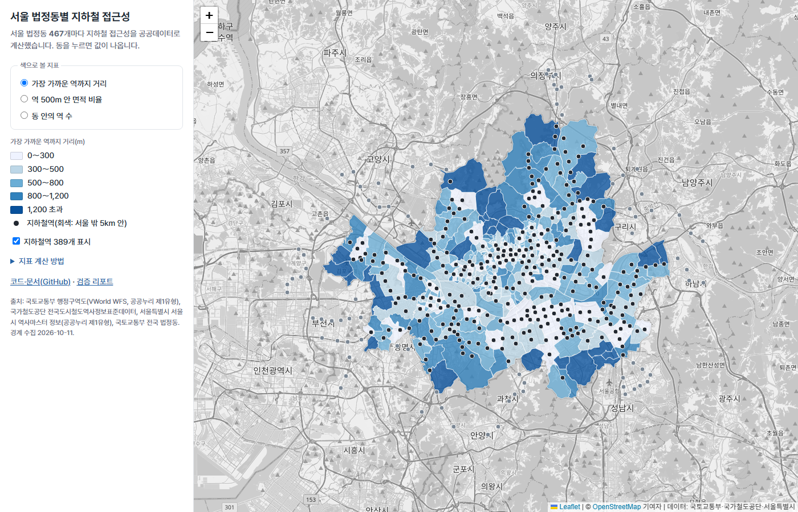

# 서울 법정동별 지하철 접근성 지도

> **공개 지도**: https://kiminseok-da.github.io/DA_Seoul_Subway_Access_GIS/ (로그인 없이 열림)

서울 법정동 467개마다 지하철 접근성 지표를 공공데이터로 계산하고, 자동 검증을 통과한 결과만 ArcGIS(Hosted Feature Layer·Web Map)와 공개 지도로 내보내는 개인 프로젝트입니다.

## 한눈에

| 항목 | 내용 |
|---|---|
| 파이프라인 | 공공데이터 API·파일 수집 → 역 정제·좌표 보정 → 지표 계산(EPSG:5179) → 자동 검증 21개 → 공개 지도·내려받기 → (선택) ArcGIS 게시. `python src/run.py` 한 번, 약 50초 |
| 결과 | 법정동 467개, 분석 역 389개(서울 안 307 + 서울 밖 5km 안 82). 가장 가까운 역까지 직선거리 중앙값 412m, 최대 2,928m(종로구 평창동) |
| 검증 | 21개 자동 검사, PostGIS(SQL)로 다시 계산해 467개 동 완전 일치, ArcGIS 서버 값과 로컬 값 전수 일치 |
| 원본 오류 발견 | 이촌역(4호선)·마곡역(5호선) 좌표 오류, 이수역(7호선) 중복 행 → 서울시 데이터와 대조해 보정, 다시 생기면 검증이 막음 |
| 도보 비교 | ArcGIS 경로 서비스 1,401건: 실제 도보 거리는 직선의 중앙값 1.36배(412m → 618m) |
| 공개 | [공개 지도](https://kiminseok-da.github.io/DA_Seoul_Subway_Access_GIS/)(Leaflet), GeoPackage·Shapefile·CSV 내려받기, ArcGIS 결과 화면(아래) |

## 지표

| 지표 | 계산 | 의미 |
|---|---|---|
| `near_dist_m` | 동 대표점에서 가장 가까운 역까지 직선거리(m) | 동네에서 역이 얼마나 먼가 |
| `n_station` | 동 경계 안의 역 수(노선 중복 제거) | 역이 몰린 동 |
| `cover_500m` | 역 500m 반경이 동 면적을 덮는 비율(%) | 동의 몇 %가 역세권인가 |

- 거리·면적은 투영 좌표계 EPSG:5179에서 계산하고, 공개 결과는 EPSG:4326으로 냅니다.
- 대표점은 폴리곤 안에 항상 들어가는 `representative_point()`를 씁니다(오목한 동에서는 중심점이 동 밖으로 나갈 수 있음).
- 서울 경계 근처 동은 서울 밖 역이 더 가까울 수 있어, 역은 서울과 주변 완충 범위까지 포함합니다.

## 데이터 출처

| 데이터 | 출처 | 기준일 | 이용 조건 |
|---|---|---|---|
| 지하철역 좌표 | 공공데이터포털 [전국도시철도역사정보표준데이터](https://www.data.go.kr/data/15013205/standard.do) (국가철도공단) | 파일 2026-06-30, 행별 2022～2026 | 이용허락범위 제한 없음 |
| 역 좌표 대조 | 서울 열린데이터광장 [서울시 역사마스터 정보](https://data.seoul.go.kr/dataList/OA-21232/S/1/datasetView.do) (서울특별시) | 수집 2026-10-11 | 공공누리 제1유형(출처표시) |
| 법정동 경계 | [국토교통부_행정구역도(WMS/WFS)](https://www.data.go.kr/data/15059008/openapi.do) 읍면동 `lt_c_ademd_info`, VWorld WFS | 수집 2026-10-11 | 공공누리 제1유형(출처표시) |
| 법정동코드 표 | 공공데이터포털 [국토교통부_전국 법정동_20260630](https://www.data.go.kr/data/15063424/fileData.do) | 2026-06-30 | 이용허락범위 제한 없음 |

원본 응답(`data/raw/`)은 저장소에 올리지 않습니다. 위 출처에서 다시 받을 수 있습니다. 이용 조건 확인 내용은 [`docs/의사결정/1011_03_데이터_이용조건과_경계.md`](docs/의사결정/1011_03_데이터_이용조건과_경계.md)에 있습니다.

## 실행

**준비**

1. 역 원본: 공공데이터포털 [전국도시철도역사정보표준데이터](https://www.data.go.kr/data/15013205/standard.do)에서 전체 파일(xlsx)을 받아 `data/raw/전체_도시철도역사정보_20260630.xlsx`로 둡니다(원본이라 저장소에 없음. 파일 이름이 다르면 `src/build_stations.py`의 `NAT`를 고칩니다)
2. `.env.example`을 `.env`로 복사하고 값을 넣습니다: `VWORLD_API_KEY`(VWorld 인증키), `SEOUL_API_KEY`(서울 열린데이터광장 인증키). ArcGIS 게시·도보 비교를 할 때만 `ARCGIS_*`(ArcGIS Location Platform 계정), PostGIS 교차 검증을 할 때만 `POSTGIS_PASSWORD`

**실행** (Windows 기준, Python 3.12)

```
uv venv --python 3.12 .venv
uv pip install --python .venv -r requirements.txt
.venv/Scripts/python src/run.py                 # 수집 → 정제 → 지표 → 검증 → 공개 지도·내려받기 파일 (약 50초)
.venv/Scripts/python src/run.py --skip-collect  # 한 번 수집한 뒤: API를 다시 부르지 않고 data/raw/ 캐시로
.venv/Scripts/python src/run.py --publish       # 검증을 통과했을 때만 ArcGIS 레이어 갱신
```

선택 검증: `docker compose up -d` 후 `.venv/Scripts/python src/crosscheck_postgis.py`(PostGIS 교차 검증), `.venv/Scripts/python src/routing_compare.py`(도보 비교, ArcGIS 경로 서비스 약 1,400건 사용. 저장한 응답으로 다시 계산만 하려면 `--from-raw`)

| 단계 | 파일 | 하는 일 |
|---|---|---|
| 수집 | `src/collect_seoul_stations.py` | 서울시 역사마스터 784건(받은 건수 = 응답 총건수 확인) |
| 수집 | `src/collect_boundaries.py` | VWorld WFS(OGC Filter)로 서울 법정동 467개, 법정동코드 표와 코드 단위 대조 |
| 정제 | `src/build_stations.py` | 역 이름 통일, 좌표 오류 보정, 노선별 행을 역 단위로 통합 |
| 지표 | `src/compute_metrics.py` | EPSG:5179에서 `near_dist_m`·`n_station`·`cover_500m` 계산 |
| 검증 | `src/validate.py` | 21개 검사, 실패하면 종료 코드 1 |
| 교차 검증(선택) | `src/crosscheck_postgis.py`, `sql/metrics.sql` | Docker PostGIS에서 같은 지표를 SQL로 다시 계산해 대조(`docker compose up -d` 후 실행) |
| 도보 비교(선택) | `src/routing_compare.py` | ArcGIS 경로 서비스로 대표점→역 도보 거리(1,401건)를 구해 직선거리와 비교, 요약만 공개 |
| 공개 지도 | `src/build_web.py` | 검증 통과 시 경계를 단순화(1m, 동별 면적 차이 1% 넘으면 중단)해 `docs/map/data.js` 생성 → GitHub Pages(Leaflet) |
| 내려받기 | `src/export_formats.py` | GeoPackage·Shapefile·CSV 내보내기, 다시 읽어 원본과 건수·값 대조 |
| 게시 | `src/publish.py` | 검증 통과 시 Hosted Feature Layer 2개를 File Geodatabase로 게시, 이후 같은 항목 덮어쓰기, 항목 정보(출처·이용 조건·기준일) 작성 |

## 검증

검증이 하나라도 실패하면 업로드하지 않습니다. 최근 결과: [`outputs/validation_report.md`](outputs/validation_report.md) — **21개 검사 통과**.

- 건수·코드: 경계 467개 = 법정동코드 표의 서울 법정동 467개, 코드 집합 일치, 조인 손실 없음
- 도형: 유효한 폴리곤, 빈 도형 없음, 좌표계 EPSG:4326
- 범위: 경계·역이 서울(+완충) 범위 안
- 좌표 겹침·이중 집계: 이름이 다른 역이 50m 안에 겹치지 않음(좌표 복사 오류), 같은 노선의 이름이 다른 역이 300m 안에 없음(같은 역 이중 집계)
- 기준점 대조: 역 도로명주소의 괄호 안 법정동과 실제 위치 대조(242쌍, 모두 경계에서 96m 안)
- 지표 상식: `cover_500m` 0～100, `near_dist_m` 최대값이 완충 거리(5km) 미만, 동 안 역 수 합 = 서울 안 역 수
- 최신성: 경계 수집일, 역별 데이터 기준일

**PostGIS 교차 검증**: 같은 원본을 Docker의 PostGIS에 넣고 지표를 SQL(`ST_Transform`, `ST_DWithin`, `ST_PointOnSurface`와 KNN `<->`, `ST_Within`, `ST_Buffer`·`ST_Intersection`)로 다시 계산했습니다. 467개 동 모두 Python 결과와 완전히 일치합니다([`outputs/postgis_crosscheck.md`](outputs/postgis_crosscheck.md)). 버퍼 원의 분할 수만 바꿔도 251개 동이 달라지는 것을 확인해, 비교가 작은 차이도 잡는다는 것을 검증했습니다.

**도보 거리 비교(ArcGIS 경로 서비스)**: 동 대표점에서 가까운 역 3개까지 도보 경로 1,401건을 구했습니다. 같은 역까지 도보 거리는 직선의 중앙값 **1.36배**, 가장 가까운 역까지 중앙값은 직선 412m → 도보 **618m**이고, 467개 동 중 281개가 도보로 보면 거리 구간이 한 단계 이상 멀어집니다([`outputs/routing_summary.md`](outputs/routing_summary.md)). 경로 결과의 저장·공개 조건을 확인하지 못해 동별 값은 공개하지 않고 요약만 싣습니다.

**발견한 원본 오류**: 공공데이터 원본에서 4호선 이촌역 좌표가 신용산역과 14m, 5호선 마곡역 좌표가 발산역과 7m 떨어져 있었습니다(실제로는 각각 1km 안팎). 서울시 역사마스터와 대조해 보정했고, 보정하지 않은 데이터로 검증을 돌리면 실패하는 것을 확인했습니다. 보정 내역: [`outputs/station_fixes.csv`](outputs/station_fixes.csv). 또 7호선 이수역이 `이수`와 `총신대입구(이수)` 두 행으로 중복되어 있어, 한 역이 두 번 세어지던 것을 독립 재검증에서 찾아 고쳤습니다.

## 데이터 내려받기

공개 지도 왼쪽 "데이터 내려받기"나 아래 링크에서 받을 수 있습니다. 좌표계 EPSG:4326, 인코딩 UTF-8. 이용 시 위 데이터 출처를 표시해 주세요.

| 포맷 | 파일 | 비고 |
|---|---|---|
| GeoPackage | [`seoul_subway_access.gpkg`](docs/downloads/seoul_subway_access.gpkg) | 레이어 `emd`(법정동 467), `stations`(역 389) |
| Shapefile | [법정동](docs/downloads/seoul_subway_access_emd_shp.zip) · [역](docs/downloads/seoul_subway_access_stations_shp.zip) | 필드 이름 10자 제한: `near_station`→`near_stn`, `near_dist_m`→`near_dist`, `coord_fixed`→`coord_fix` |
| CSV | [법정동](docs/downloads/seoul_subway_access_emd.csv) · [역](docs/downloads/seoul_subway_access_stations.csv) | 도형 없이 속성 + 점 좌표(법정동은 대표점 `rep_lon`·`rep_lat`) |
| GeoJSON | [법정동](data/processed/seoul_emd_metrics.geojson) · [역](data/processed/stations_study.geojson) | 파이프라인 결과 원본 |

**필드**

| 필드 | 뜻 |
|---|---|
| `bjd_cd` | 법정동코드(10자리, 문자열) |
| `sgg_cd`·`sgg_nm`·`emd_nm`·`full_nm` | 시군구코드·구 이름·법정동 이름·전체 이름 |
| `area_km2` | 면적(㎢, EPSG:5179) |
| `near_station`·`near_dist_m` | 가장 가까운 역과 대표점에서의 직선거리(m) |
| `n_station` | 동 경계 안의 역 수(환승역 1개) |
| `cover_500m` | 역 500m 반경이 덮는 면적 비율(%) |
| `collected` | 경계 수집일 |
| `station_id`·`name`·`name_full` | 역 ID·통일 이름·원래 표기 |
| `lines`·`n_lines`·`operators` | 노선 목록(`;` 구분)·노선 수·운영기관 |
| `in_seoul`·`coord_fixed` | 서울 안 여부·원본 좌표 보정 여부(1=예) |
| `ref_date` | 역 데이터 기준일(노선별 행 중 가장 최근) |

## 결과 화면

**공개 지도(GitHub Pages, Leaflet)**



### ArcGIS Online

Python(`src/publish.py`)으로 Hosted Feature Layer 2개를 게시·갱신하고, Map Viewer로 웹맵을 구성했습니다.

**웹맵: 가장 가까운 역까지 거리(단계구분도) + 지하철역(점)**


| 법정동 팝업 | 역 팝업 |
|---|---|
|  |  |

**코드로 채운 항목 정보(요약·설명·출처·이용 조건)와 게시된 항목**

| 법정동 레이어 항목 | 역 레이어 항목 |
|---|---|
|  |  |


**공개 범위**: ArcGIS Location Platform 무료 계정은 Hosted Feature Layer의 공개(Everyone) 공유를 지원하지 않습니다([Esri 문서](https://developers.arcgis.com/documentation/portal-and-data-services/data-services/feature-services/sharing-and-security/)). 그래서 ArcGIS 항목은 비공개로 운영하고, 결과는 위 화면으로 보여 줍니다. 로그인 없이 열어 볼 수 있는 지도는 [GitHub Pages](https://kiminseok-da.github.io/DA_Seoul_Subway_Access_GIS/)로 따로 제공합니다(같은 결과 파일, Leaflet).

## 한계

- 지표는 직선거리입니다. 도보 거리는 중앙값 1.36배 길고(위 도보 비교), 출입구 위치는 반영하지 않습니다
- 법정동 경계가 한강까지 이어지는 동은 대표점이 강변에 찍힐 수 있어, 그 동의 거리 지표가 실제 주거지 기준과 다를 수 있습니다(토정동·양평동 등)
- GTX-A는 기준 데이터에 없어 넣지 않았습니다. 서울 안 GTX 역은 기존 역과 같은 자리라 영향이 작습니다
- 역 데이터의 기준일이 운영기관마다 2022～2026으로 다릅니다
- 법정동은 크기가 0.01～18㎢로 차이가 커서, 산지가 넓은 동(평창동 등)은 `near_dist_m`가 크게 나옵니다
- ArcGIS 항목은 Location Platform 무료 계정의 공유 제한으로 비공개입니다(결과는 캡처와 공개 지도로 제공)

## 의사결정 기록

| 문서 | 내용 |
|---|---|
| [1011_01 작업 범위](docs/의사결정/1011_01_작업범위.md) | 핵심과 확장(WFS·다중 포맷·PostGIS·Routing·공개 지도), Web Scene 제외 |
| [1011_02 역 정제 규칙](docs/의사결정/1011_02_역_정제_규칙.md) | 이름 정규화, 서울시 데이터와 좌표 대조, 중복 행 제거, 역 통합 |
| [1011_03 데이터 이용 조건과 경계](docs/의사결정/1011_03_데이터_이용조건과_경계.md) | 4개 데이터 이용 조건, VWorld WFS 수집과 코드 대조 |
| [1011_04 지표와 검증](docs/의사결정/1011_04_지표와_검증.md) | 지표 정의, 검증 21개, 독립 재검증, 음성 시험 |
| [1011_05 ArcGIS 게시](docs/의사결정/1011_05_ArcGIS_게시.md) | 계정 선택, FGDB 업로드(코드 타입 유지), 덮어쓰기, 공개 공유 제한 |
| [1012_01 공개 지도](docs/의사결정/1012_01_공개_지도.md) | GitHub Pages·Leaflet, 배경지도, 경계 단순화 1m |
| [1012_02 다중 포맷](docs/의사결정/1012_02_다중_포맷.md) | GPKG·Shapefile·CSV, 같은 데이터면 같은 파일 |
| [1012_03 PostGIS 교차 검증](docs/의사결정/1012_03_PostGIS_교차검증.md) | SQL 재계산, 467개 동 일치, 비교 민감도 시험 |
| [1012_04 도보 거리 비교](docs/의사결정/1012_04_도보_거리_비교.md) | ArcGIS 경로 서비스, 이상치, 요약만 공개 |

## 회고

**잘 된 것**
- 검증을 파이프라인 안에 넣었다. 검증이 실패하면 공개 지도·내려받기·ArcGIS 게시가 모두 멈춘다
- 같은 결과를 다른 방법(측지 거리, 다른 공간 함수, 격자 표본, PostGIS SQL, 서버 값 전수 대조)으로 다시 계산했고, 이 과정에서 원본 중복 행(이수역)으로 인한 이중 집계를 찾았다
- 검사를 만들면 오류를 되돌린 데이터로 일부러 실패시키는 시험(음성 시험)을 같이 했다

**아쉬운 것**
- ArcGIS 계정을 고를 때 게시 권한만 확인하고 공개 공유 지원 여부를 확인하지 않아, 웹맵을 만든 뒤에야 Location Platform은 레이어 공개가 안 된다는 것을 알았다
- 공개 지도의 경계 단순화(처음 5m)를 처음부터 동별 면적 차이로 확인하지 않았다
- 동 대표점이 한강변에 찍히는 동은 거리 지표가 주거지 기준과 다를 수 있다

**다음에는**
- 계정·서비스를 고를 때 "게시·공유·이용 조건"을 점검표로 먼저 확인한다
- 대표점 대신 건물·인구 가중 중심을 쓰고, 도보 거리를 공개 지표로 넣을 수 있는지 이용 조건을 확인한다

## AI 협업 방식

이 프로젝트는 AI 코딩 도구(Claude Code)와 함께 만들었습니다. AI에게 무엇을 맡기고, 어떤 규칙으로 지시하고, 결과를 어떻게 검증했는지를 아래 파일에 남깁니다.

| 보는 순서 | 파일 | 내용 |
|---|---|---|
| 1 | [`AGENTS.md`](AGENTS.md) | AI에게 주는 작업 지시: 수치 지어내기 금지, 법정동코드 조인과 건수 대조, 투영 좌표계 계산, 검증 실패 시 업로드 금지. `CLAUDE.md`는 이 파일을 불러오는 한 줄 |
| 2 | [`docs/AI_활용_기록.md`](docs/AI_활용_기록.md) | 작업 단위마다 **AI가 한 것 / 내가 판단한 것 / AI가 틀린 것과 잡은 방법** |
| 3 | [`docs/의사결정/`](docs/의사결정/) | 선택지와 결정, 근거, 바꾸는 조건, 처리 전후 건수 |
| 4 | [`HANDOFF.md`](HANDOFF.md), [`docs/작업일지/`](docs/작업일지/) | 세션이 바뀌어도 이어서 일하도록 남기는 현재 상태와 날짜별 기록 |

- 커밋에는 AI 공동 작성자 표시를 넣지 않습니다(`.claude/settings.json`, `.githooks/`). 대신 AI가 한 일은 위 기록에 따로 남깁니다
- API 키·로그인 정보·비공개 메모는 `.gitignore`로 저장소에서 뺐습니다
- AI가 만든 결과는 단계마다 다른 방법으로 다시 계산해 확인했습니다. AI가 틀린 것(운전 거리를 도보로 계산할 뻔한 것, 계정의 공개 공유 제한을 놓친 것, 행이 섞일 수 있는 코드 등)과 잡은 방법은 활용 기록에 그대로 남겼습니다
